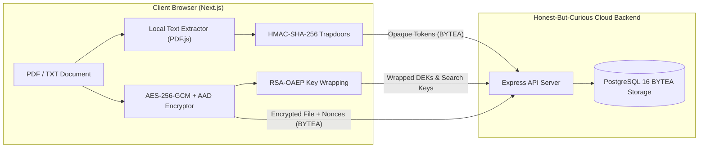

# CipherShare — Secure Searchable Cloud Document Sharing

[](docs/cryptographic-design.md)
[](packages/shared)
[-brightgreen.svg)](docs/testing-report.md)
[](package.json)

**CipherShare** is an end-to-end full-stack web application demonstrating **Searchable Symmetric Encryption (SSE)** and authenticated cloud document collaboration on an untrusted, honest-but-curious storage backend.

Documents and search trapdoors are generated locally in the browser via the W3C Web Cryptography API before transmission. The cloud database and application server store and operate solely on encrypted payloads and opaque tokens—never learning plaintext document contents, filenames, or search keywords.

---

## 1. Cryptographic Architecture



### Cryptographic Primitives & Parameters
- **Document Encryption**: **AES-256-GCM** with a random 256-bit DEK per document, a 96-bit unique nonce, a 128-bit authentication tag, and versioned **Additional Authenticated Data (AAD)** bound to `workspaceId` and `documentId`.
- **Searchable Encryption**: **HMAC-SHA-256** computed over normalized Unicode NFC alphanumeric terms:
  $$T_w = \text{HMAC-SHA-256}(K_{\text{ws}}, \text{"ciphershare\|"} \mathbin{\Vert} \text{workspaceId} \mathbin{\Vert} \text{"\|"} \mathbin{\Vert} w)$$
- **Key Distribution & Sharing**: **RSA-OAEP** with a 3072-bit modulus, public exponent $e=65537$, and SHA-256 hashing.
- **Private-Key Protection**: User private keys (PKCS8) are encrypted locally using AES-256-GCM with a key derived via **Argon2id** ($m=64\text{ MB}, t=3, p=1$) and a 16-byte random salt.
- **Password Authentication**: Account passwords are independently hashed on the backend using **Argon2id**.

---

## 2. Monorepo Structure

```
ciphershare/
├── apps/
│   ├── web/                     # Next.js 14 App Router (Client Cryptography & UI)
│   └── api/                     # Express.js + Prisma ORM (Backend API & Inverted Index)
├── packages/
│   └── shared/                  # Universal Cryptography Primitives, Types & Schemas
├── docs/                        # Complete Cryptographic & Engineering Documentation
│   ├── architecture.md          # Monorepo architecture & data-flow diagrams
│   ├── threat-model.md          # Honest-but-curious assumptions & leakage analysis
│   ├── cryptographic-design.md  # Primitives, formulas & key lifecycle
│   ├── database-design.md       # PostgreSQL schema & BYTEA index rationale
│   ├── api-documentation.md     # REST endpoint contracts & payloads
│   └── testing-report.md        # 14 security criteria verification & benchmarks
├── docker-compose.yml           # Local PostgreSQL 16 container
├── package.json                 # Monorepo configuration (npm workspaces)
└── README.md
```

---

## 3. Quick Start & Local Execution

### Prerequisites
- Node.js 18+ (tested on Node v22.15.1)
- npm 9+
- Docker & Docker Compose (for local PostgreSQL)

### 1. Clone & Install Dependencies
```bash
git clone <repository-url>
cd proj
npm install
```

### 2. Start PostgreSQL via Docker Compose
```bash
docker compose up -d
```
*(Alternatively, point `DATABASE_URL` in `.env` to an existing PostgreSQL 14+ instance).*

### 3. Initialize Database Schema (Prisma)
```bash
npm run db:generate
npm run db:migrate --workspace=@ciphershare/api
```

### 4. Run the Full Stack
Open two terminal windows:

**Terminal 1 — Express Backend API (Port 4000):**
```bash
npm run dev:api
```

**Terminal 2 — Next.js Frontend (Port 3000):**
```bash
npm run dev:web
```

Visit **`http://localhost:3000`** in your browser.

---

## 4. Automated Testing Suite

CipherShare includes **43 automated unit, integration, security, and benchmark tests**:

```bash
# Run all tests across the monorepo
npm run test
```

### Test Breakdown
- **11 Cryptographic Unit Tests** (`packages/shared/tests/crypto.test.ts`):
  - RSA-OAEP 3072 key generation, SPKI/PKCS8 export/import
  - Argon2id AES-GCM private key protection, correct password unlock, wrong password rejection
  - AES-256-GCM authenticated encryption, AAD validation, bit-tampering rejection
  - Text normalization (NFC, lowercase, alphanumeric, deduplication)
  - HMAC token determinism and cross-workspace independence
- **16 API Integration Tests** (`apps/api/tests/api.test.ts`):
  - Registration, login, workspace creation, member key distribution
  - Document upload with BYTEA storage, inverted index insertion
  - Conjunctive AND search, zero matches on missing tokens
  - Sharing DEK envelopes, recipient decryption, revocation blocking
- **14 Mandatory Security Property Tests** (`apps/api/tests/security.test.ts`):
  - Verifies all 14 criteria from Section 14 of the project specification
- **2 Benchmark Tests** (`packages/shared/tests/benchmark.test.ts`):
  - Measures encryption/decryption throughput and inverted index build latencies

---

## 5. Live Demonstration Scenario (Semester Project Evaluation)

To present the project to your professor or evaluator, follow this step-by-step workflow:

1. **Alice Registers & Generates Keys**:
   - Navigate to `/register`. Register as `alice@ciphershare.io`.
   - The browser generates an RSA-OAEP 3072-bit key pair and derives an AES key via Argon2id to encrypt Alice's private key before upload.
2. **Bob Registers**:
   - Open an Incognito/Private window. Navigate to `/register`. Register as `bob@ciphershare.io`.
3. **Alice Creates a Workspace**:
   - Under `/dashboard/workspaces`, Alice creates a new workspace (e.g. *"Research Group"*).
   - Alice's browser generates a random 32-byte workspace search key and wraps it with her public key.
4. **Alice Enrolls Bob in the Workspace**:
   - Alice clicks *"Distribute Search Key"* and adds `bob@ciphershare.io`.
   - Alice's browser unwraps the search key locally, re-wraps it with Bob's public key, and stores the envelope on the server.
5. **Alice Encrypts and Uploads Documents**:
   - Under `/dashboard/documents`, Alice selects a PDF or TXT file (e.g. containing terms *"cryptography"*, *"security"*).
   - Alice's browser extracts text via PDF.js, derives HMAC tokens, encrypts the document with a unique DEK using AES-256-GCM + AAD, and uploads the ciphertext to PostgreSQL.
6. **Inspect PostgreSQL Database (Proof of Confidentiality)**:
   - Run `SELECT id, encode(encrypted_file, 'hex') FROM documents;`.
   - **Observation**: The stored data is purely high-entropy binary ciphertext. The original filename, extracted text, and plaintext keywords do not exist in the database.
7. **Alice Executes an Encrypted Search**:
   - Under `/dashboard/search`, Alice searches for *"cryptography"*.
   - Alice's browser computes the HMAC token locally and submits it to Express.
   - The server matches the opaque token in `search_index` and returns Alice's document.
   - Alice's browser unwraps the DEK and decrypts the document locally.
8. **Alice Shares Document with Bob**:
   - Under `/dashboard/documents`, Alice clicks the share icon next to the document, enters `bob@ciphershare.io`, and clicks *"Share DEK"*.
   - Alice's browser unwraps the DEK and encrypts it with Bob's RSA-OAEP public key.
9. **Bob Searches and Decrypts the Shared Document**:
   - In Bob's window, navigate to `/dashboard/search` or `/dashboard/shared`.
   - Bob can search for the document's keyword, retrieve the ciphertext, unwrap the DEK with his private key, and download the decrypted file.
   - Bob cannot access unshared documents.
10. **Alice Revokes Bob's Access**:
    - Alice revokes Bob's access. Subsequent download requests by Bob immediately return HTTP 404/403.

---

## 6. Empirical Performance Results

Tested on local hardware with 10 repetitions per benchmark:

| Metric | 10 KB Payload | 100 KB Payload | 1 MB Payload | 5 MB Payload |
| :--- | :---: | :---: | :---: | :---: |
| **AES-256-GCM Encryption Mean** | 0.47 ms | 0.34 ms | 1.58 ms | 5.66 ms |
| **AES-256-GCM Decryption Mean** | 0.23 ms | 0.24 ms | 2.20 ms | 7.17 ms |

| Document Corpus | Terms Indexed | Index Build Time | Per-Token Latency | Storage Overhead |
| :--- | :---: | :---: | :---: | :---: |
| **100 Documents** | 5,000 | 238 ms | 48 μs | 2.13x |
| **500 Documents** | 25,000 | 1,060 ms | 42 μs | 2.13x |
| **1,000 Documents** | 50,000 | 1,520 ms | 30 μs | 2.13x |

---

## 7. Threat Model & Known Leakage

CipherShare assumes an **honest-but-curious cloud adversary**. The cloud operator cannot decrypt documents or read plaintext queries, but learns:
- **Search Pattern**: Whether the same keyword was queried repeatedly (due to deterministic HMAC tokens).
- **Access Pattern**: Which encrypted document IDs match a given trapdoor.
- **Volume & Size**: Approximate ciphertext file lengths and keyword frequencies.

For the full security analysis, see [`docs/threat-model.md`](docs/threat-model.md).

---

## 8. License

This project was developed for the Applied Cryptography semester curriculum and is distributed under the [MIT License](LICENSE).
