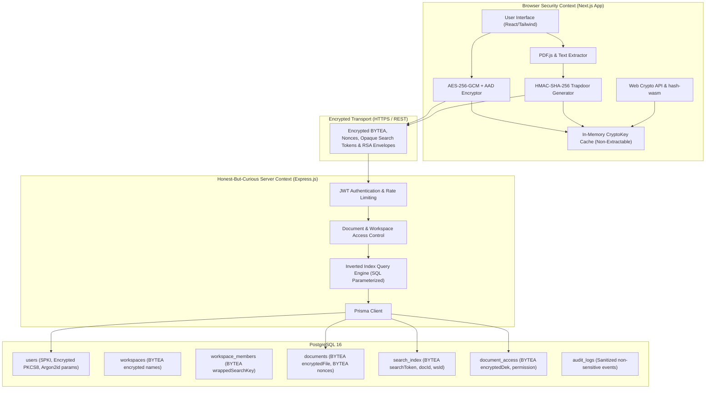

# CipherShare — System Architecture Specification

## 1. Monorepo Organization

CipherShare is structured as a TypeScript monorepo with strict separation of cryptographic responsibilities:

```
ciphershare/
├── apps/
│   ├── web/                     # Next.js 14 App Router (Client-side Cryptography & UI)
│   └── api/                     # Express.js + Prisma ORM (Metadata, BYTEA Storage & Access Control)
├── packages/
│   └── shared/                  # Universal Cryptographic Library, Types, Constants & Schemas
├── docs/                        # Complete Cryptographic & Engineering Documentation
├── docker-compose.yml           # Local PostgreSQL 16 Deployment
├── package.json                 # Monorepo Workspace Root
└── README.md
```

## 2. Layer Separation & Security Boundaries



## 3. Cryptographic State Machine

1. **User Identity Initialization**:
   - `generateUserKeyPair()` creates a 3072-bit RSA-OAEP key pair extractable only in client memory.
   - `protectPrivateKey()` derives an AES-GCM key from the user password using Argon2id (`timeCost=3, memoryCost=64MB, parallelism=1`) and encrypts the PKCS8 private key with a fresh 12-byte nonce.
   - SPKI public key and encrypted private key package are uploaded to Express.

2. **Workspace Creation & Key Distribution**:
   - A 32-byte cryptographically secure random workspace search key is generated locally.
   - The creator encrypts the key with their RSA-OAEP public key (`wrapKeyForRecipient`).
   - When inviting Bob, Alice unwraps the search key locally using her private key, re-encrypts it using Bob's RSA-OAEP public key, and uploads the envelope to `workspace_members`.

3. **Document Ingestion**:
   - User selects a file (PDF or TXT).
   - Text is parsed page-by-page via PDF.js entirely in browser memory.
   - Text is normalized (Unicode NFC, lowercase, alphanumeric tokens, deduplicated).
   - Trapdoor generation: `HMAC-SHA-256(workspaceSearchKey, "ciphershare|" + workspaceId + "|" + keyword)`.
   - File encryption: 32-byte fresh DEK encrypts file with `AES-256-GCM` using 12-byte nonce and versioned AAD bound to `workspaceId` and `documentId`.
   - DEK is wrapped using the owner's RSA-OAEP public key.
   - Ciphertext bytes are transmitted and saved directly in PostgreSQL BYTEA.

4. **Encrypted Querying**:
   - User types a search query.
   - Browser computes HMAC trapdoors for all query terms.
   - Express queries `search_index` joined with `document_access` requiring active workspace membership and document-level permission.
   - Express returns matching document metadata and encrypted DEKs.
   - Browser decrypts metadata and downloads/decrypts document on demand.
