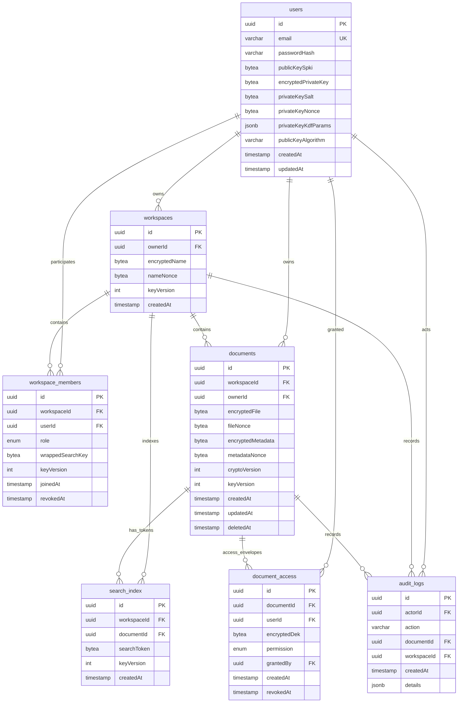

# CipherShare — Database Design & Schema Specification

## 1. Schema ER Diagram

---

## 2. PostgreSQL BYTEA Justification

In CipherShare, all cryptographic data (ciphertexts, nonces, search tokens, wrapped keys, public/private key binaries) are stored directly as **`BYTEA`**:
1. **Zero Encoding Overhead**: Avoids 33% storage inflation caused by Base64 string representations in database storage.
2. **Binary Index Performance**: PostgreSQL evaluates B-Tree indexes over 32-byte `BYTEA` HMAC tokens substantially faster than string comparisons.
3. **Strict Tamper Detection**: Binary byte comparisons ensure nonces and GCM authentication tags cannot be altered by collation or character set transformations.

---

## 3. Indexing Strategy & Conjunctive Query Optimization

- `search_index`:
  - `@@unique([workspaceId, documentId, keyVersion, searchToken])` enforces duplicate token suppression per document.
  - `@@index([workspaceId, keyVersion, searchToken])` enables fast binary index lookups for trapdoor matching.
  - `@@index([documentId])` optimizes cascade deletion.
- `document_access`:
  - `@@unique([documentId, userId])` prevents duplicate access records.
  - `@@index([userId, revokedAt])` optimizes permission resolution and the "Shared with Me" view.
